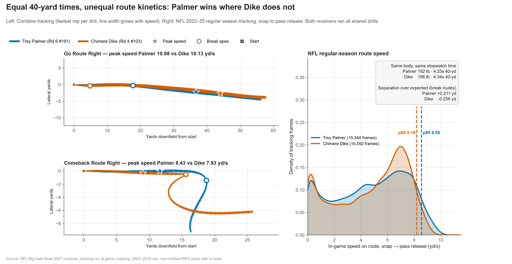

# From Track Speed to Route Kinetics

**`nfl-big-data-bowl-2027-route-kinetics`** — *Decoding NFL Combine Skill Drills to Predict Wide Receiver Separation (NFL Big Data Bowl 2027)*

[](https://www.python.org/)
[](https://pola.rs/)
[](https://scikit-learn.org/)
[](https://lightgbm.readthedocs.io/)
[](tests/test_wr_pipeline.py)
[](https://www.kaggle.com/competitions/nfl-big-data-bowl-2027)

## Direct Links

- **Kaggle Competition Writeup**: [From Track Speed to Route Kinetics — NFL Big Data Bowl 2027](https://www.kaggle.com/competitions/nfl-big-data-bowl-2027/writeups/from-track-speed-to-route-kinetics)
- **Public Kaggle Notebook**:[From Track Speed to Route Kinetics (Reproducible Kernel)](https://www.kaggle.com/code/vangnguyenvu1503/from-track-speed-to-route-kinetics) · *(local: [`notebooks/submission_writeup_kaggle.ipynb`](notebooks/submission_writeup_kaggle.ipynb))*
- **Public Kaggle Source Dataset**: [nfl-bdb-2027-wr-route-kinetics-src](https://www.kaggle.com/datasets/vangnguyenvu1503/nfl-bdb-2027-wr-route-kinetics-src) · *(local: [`kaggle_dataset_src/`](kaggle_dataset_src/))*

---

This repository quantifies how NFL Combine wide-receiver skill-drill tracking translates into separation on NFL Sundays across 510 Combine prospects (five positions, including 107 wide receivers tracked across 1,529 drill reps) matched to 31,035 regular-season route plays and 927,243 active in-game tracking frames. By segmenting trajectories strictly before the final 20% walk-off window, Z-scoring within physics-homogeneous drill families, and removing play-context bias (`soe_break`), our 100%-sensor `pure_kinetics_z` feature adds statistically significant predictive power beyond body size, 40-yard dash time, and NGS Athleticism Score. On identical Combine frames and 40-yard times (192 lb / 4.33s vs. 196 lb / 4.34s), Trey Palmer (+0.211 yd `soe_break`) outperforms Chimere Dike (-0.256 yd) by 0.47 yd in real game separation.



---

## Key Findings

- **Non-Redundant Sensor Lift (Nested OLS)**: Adding `pure_kinetics_z` (100% Combine tracking sensor, 0% `combine_weight`) on top of `combine_weight + combine_height + forty + ten_yd_split + ngs_athleticism_score` raises adjusted R² from 0.097 to 0.169 (ΔAdj R² = +0.0725, partial r = +0.306, F = 7.023, p = 0.010, LRT p = 0.007) across complete-timing receivers (N = 75). The gain replicates at N = 64 (≥ 50 snaps: partial r = +0.288, F p = 0.027) and N = 83 (median-imputed 40s: partial r = +0.221, LR p = 0.041), whereas `forty` (p = 0.89) and `ngs_athleticism_score` (p = 0.68) show no independent signal.
- **Combine-to-NFL Kinetic Translation (927,243 Active Game Frames)**: On active receivers (N = 69, ≥ 50 snaps), `vertical_route_max_s_z` translates strongly into NFL 95th-percentile route speed (`nfl_route_p95_s`, Spearman ρ = +0.455, p < 0.001) and Expected YAC (`mean_expected_yac`, ρ = +0.320, p = 0.007). Meanwhile `pure_kinetics_z` predicts both `soe_break` (ρ = +0.293, p = 0.015) and Expected YAC (ρ = +0.301, p = 0.012), and `apex_speed_retention` correlates with sharper NFL break deceleration (more negative `nfl_break_decel_p05`: Spearman ρ = -0.263, p = 0.029; Pearson r = -0.337).
- **Blind Out-of-Sample Generalization (Clean LODCO CV, 2023–2025)**: Evaluating held-out draft classes completely blind—with imputation, scaling, univariate screening, and weight-residualization fitted strictly inside each training fold—consistently favors combining route kinetics with size/track baselines (`RidgeCV`, `BayesianRidge`, `ElasticNetCV`). Across only three overlapping draft classes (N = 69–83), 2,000-replicate paired bootstrap 95% CIs on out-of-sample Δρ and ΔRMSE cross or touch zero, reflecting limited class-level sample size.
- **Draft-Room Arbitrage & Opt-Out Guardrail**: Weight-orthogonal `size_adjusted_route_kinetics` (r = 0.000 vs. `combine_weight`) highlights below-median-40 / Day 3 sleepers such as Tez Johnson (Rd 7 #235, 4.51s, +0.443 yd `soe_break`) and Jimmy Horn (Rd 6 #208, 4.46s, +0.127 yd) while flagging track-only (Chimere Dike, -0.256 yd) and 40-skip / low-separation profiles (Jack Bech, Rd 2 #58, -0.302 yd). Auditing `has_go_route` and grading skipped-drill WRs via `route_speed_z` prevents opt-outs (Dont'e Thornton, KeAndre Lambert-Smith) from distorting evaluations.

### Model Validation Summary (`soe_break`)

| Validation Cohort & Protocol | Model / Comparison | OOF R² / Adj R² | OOF RMSE (yd) | Spearman ρ / Partial r | Significance / 95% Bootstrap CI |
|:---|:---|---:|---:|---:|:---|
| Nested OLS (N = 75, complete 40) | Baseline → +`pure_kinetics_z` | Adj 0.097 → 0.169 | — | Partial r = +0.306 | F = 7.023, p = 0.010 (LR p = 0.007) |
| Nested OLS (N = 64, ≥ 50 snaps) | Baseline → +`pure_kinetics_z` | Adj 0.170 → 0.226 | — | Partial r = +0.288 | F = 5.171, p = 0.027 (LR p = 0.018) |
| Clean LODCO RidgeCV (N = 69) | Model A (Size + Track) | +0.1003 | 0.1472 | +0.261 (p = 0.030) | Baseline reference |
| Clean LODCO RidgeCV (N = 69) | Model C (Combined Clean) | **+0.1696** | **0.1414** | **+0.342** (p = 0.004) | Δρ = +0.081 [-0.075, +0.241] |
| Clean LODCO BayesianRidge (N = 69) | Model A → Model C | +0.110 → +0.174 | 0.146 → 0.141 | +0.274 → +0.343 | Δρ = +0.069 [-0.082, +0.226] |
| Clean LODCO RidgeCV (N = 83) | Model A → Model C | +0.034 → +0.131 | 0.143 → 0.136 | +0.160 → +0.260 | Δρ = +0.100 [-0.058, +0.255] |
| Clean LODCO ElasticNetCV (N = 83) | Model A → Model C | +0.020 → +0.128 | 0.144 → 0.136 | +0.151 → +0.296 | Δρ = +0.145 [-0.019, +0.298] |

---

## Project Architecture

```text
nfl-big-data-bowl-2027-route-kinetics/
├── src/                               # Local development & research pipeline
│   ├── 01_eda_audit.py                # Dataset inventory, missingness, and ID linkage audit
│   ├── 02_signal_discovery.py         # Multi-position (OL/WR/DL) feasibility screening
│   ├── 03_wr_soe_target.py            # Leave-One-Season-Out LightGBM expected separation & EB-shrunk SOE
│   ├── 04_wr_biomechanics.py          # Pre-80% Break Apex segmentation & 9 Combine biomechanical features
│   ├── 05_wr_advanced_kinetics.py     # Homogeneous drill-family Z-scores & 100%-sensor pure_kinetics_z
│   ├── 06_wr_game_tracking_bridge.py  # Lazy streaming bridge across 927k NFL regular-season route frames
│   ├── 07_wr_modeling_lodco.py        # Leave-One-Draft-Class-Out CV across RidgeCV/BayesianRidge/ElasticNetCV
│   ├── 08_wr_robustness_audit.py      # Nested OLS F-tests, opt-out audit, clean LODCO CV & bootstrap CIs
│   ├── 09_generate_visuals.py         # Publication-grade 300 DPI figures (fig1–fig5)
│   └── 10_verify_submission.py        # Automated word-count, visual-cap, metadata, and execution verifier
├── kaggle_dataset_src/                # Clean Kaggle Dataset bundle (env-aware BDB_RAW_DIR / BDB_OUT_DIR)
│   ├── 03_wr_soe_target.py .. 09_generate_visuals.py
│   └── run_all_pipeline.py            # Preflight check + end-to-end 03 → 09 orchestrator
├── tests/
│   └── test_wr_pipeline.py            # 6 pytest invariants (OOF/LODCO zero leakage, apex < 80%, weight orthogonality)
├── figures/                           # Exported 300 DPI PNG visuals & Kaggle thumbnail
│   ├── fig1_hero_palmer_vs_dike.png
│   ├── fig2_scouting_blindspot.png
│   ├── fig3_combine_to_nfl_bridge.png
│   ├── fig4_lodco_cv_performance.png
│   ├── fig5_draft_room_quadrant.png
│   └── thumbnail_kaggle.png
├── notebooks/
│   ├── submission_writeup.ipynb       # Local presentation notebook (1,753 prose words, 5 figures + 2 tables)
│   └── submission_writeup_kaggle.ipynb# Self-contained Kaggle notebook running run_all_pipeline.py end-to-end
├── requirements.txt
└── pyproject.toml
```

---

## Reproducibility

### 1. Environment & Data Setup
Create a Python 3.13 virtual environment and install dependencies (`03`–`09` require only 7 third-party packages: `polars>=1.0`, `numpy`, `scipy`, `scikit-learn`, `lightgbm`, `statsmodels`, and `matplotlib`—with zero `pandas` or `pyarrow` dependencies):

```powershell
python -m venv .venv
.\.venv\Scripts\python.exe -m pip install -r requirements.txt
```

Download the 9 competition CSV files from Kaggle's [NFL Big Data Bowl 2027](https://www.kaggle.com/competitions/nfl-big-data-bowl-2027) dataset and place them inside `data/raw/`:
- `games.csv`, `players.csv`, `player_play.csv`, `player_career_successes.csv`
- `combine_results.csv`, `combine_tracking.csv`
- `game_tracking_2023.csv`, `game_tracking_2024.csv`, `game_tracking_2025.csv`

### 2. Run the Full End-to-End Pipeline
Execute all seven modeling, audit, and visualization stages cleanly from scratch using `kaggle_dataset_src/run_all_pipeline.py`:

```powershell
$env:BDB_RAW_DIR = "data/raw"
$env:BDB_OUT_DIR = "."
.\.venv\Scripts\python.exe kaggle_dataset_src/run_all_pipeline.py
```

*(On Kaggle, `run_all_pipeline.py` automatically detects `/kaggle/input/nfl-big-data-bowl-2027` and writes processed Parquets, audit reports, and 300 DPI figures into `/kaggle/working/`.)*

### 3. Run Unit Tests & Submission Verification
Verify all six statistical/biomechanical unit tests (`tests/test_wr_pipeline.py`) and audit the Kaggle submission notebook (`notebooks/submission_writeup_kaggle.ipynb`) for word limits (< 2,000), visual budget (7 < 10), hidden-input metadata, and runtime execution:

```powershell
.\.venv\Scripts\python.exe -m pytest tests/test_wr_pipeline.py -v
.\.venv\Scripts\python.exe src/10_verify_submission.py notebooks/submission_writeup_kaggle.ipynb
```
